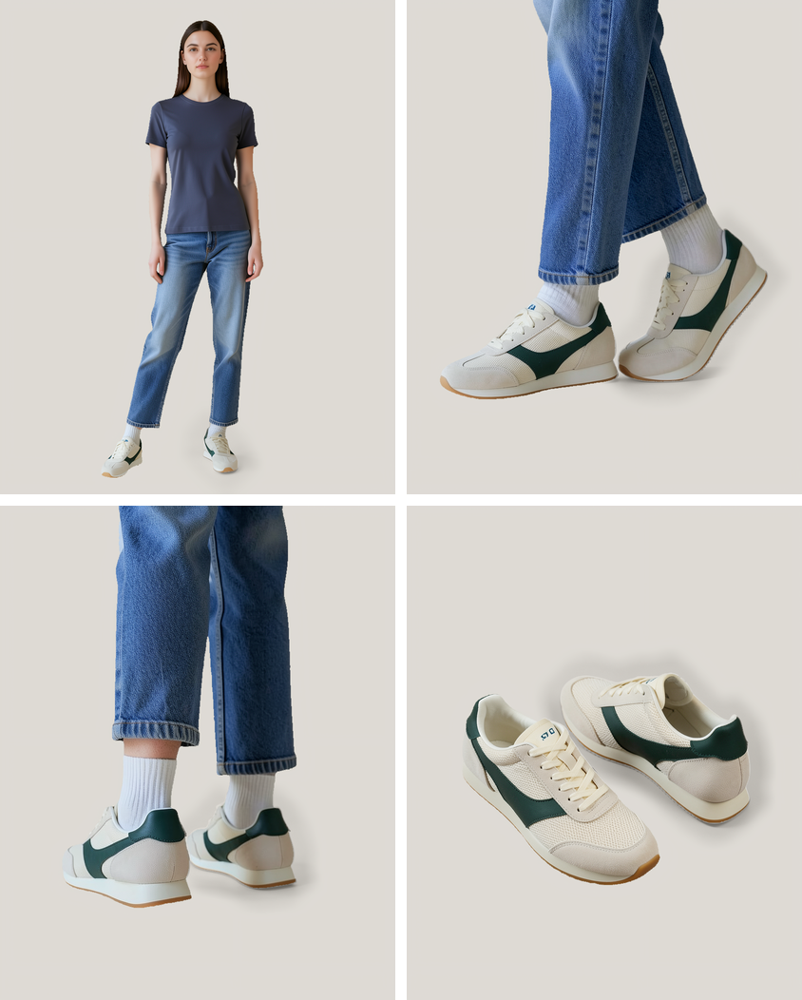

# Footwear Studio · Four Shot Session

Piotr Czapowski · DEMO-SNK-001

A four-frame e-commerce shoot made in ComfyUI from two views of one sneaker. The lateral and heel input photographs in this demo are synthetic.

## Run the workflow

Copy the two PNG files from [`input/`](input/) directly into `ComfyUI/input/`. Open [`Footwear-Studio.workflow.json`](Footwear-Studio.workflow.json) in ComfyUI and click **Run**.

The graph uses native ComfyUI nodes. The test instance runs ComfyUI 0.38.0.

| Model file | ComfyUI folder |
| --- | --- |
| `flux-2-klein-4b.safetensors` | `models/diffusion_models/` |
| `qwen3_4b_fp8_scaled.safetensors` | `models/text_encoders/` |
| `flux2-vae.safetensors` | `models/vae/` |
| `sam3-fp16.safetensors` | `models/checkpoints/` |
| `4xUltrasharp_4xUltrasharpV10.pt` | `models/upscale_models/` |

See the [ComfyUI FLUX.2 Klein guide](https://docs.comfy.org/tutorials/flux/flux-2-klein) for the model's text-to-image and image editing workflow templates.

## Shot list

1. **Full look.** Generate the cast and wardrobe, then use the side photograph to put the sneaker on the model.
2. **Outer side.** Create a new on-foot close-up using the cropped worn frame and the lateral product reference.
3. **Heel.** Create a separate rear three-quarter close-up using the worn frame and both shoe references.
4. **Pair still life.** Place a pair of the sneakers diagonally on the floor, with both shoes in frame.

SAM3 separates the subject and shoes. The compositing group uses the same warm gray plate for every shot and extracts local shadow tones near the soles. The finishing group blends a model upscale into the 2× Lanczos version, applies light sharpening and saves four **1664 × 2080 PNGs** and a 2 × 2 review sheet under `ComfyUI/output/FootwearSession/DEMO-SNK-001/`.

For another SKU, load a matching lateral and heel view in **02 SHOE REFERENCES**. Update the material and color descriptions in each shot brief and adjust the framing or fixed seed as needed. Inspect the pair count, shoe silhouette, stripe, heel tab, lacing and markings at full size. Fine details and lettering can vary between generated angles.
